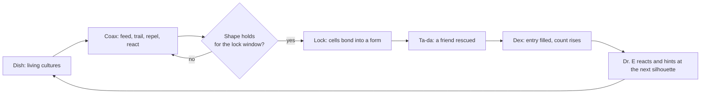
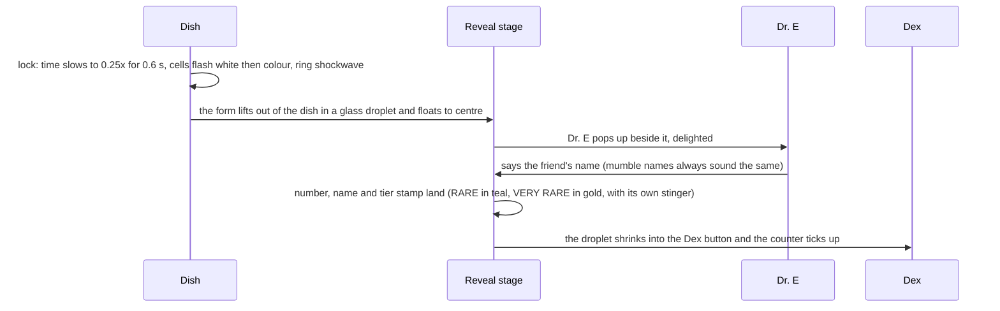
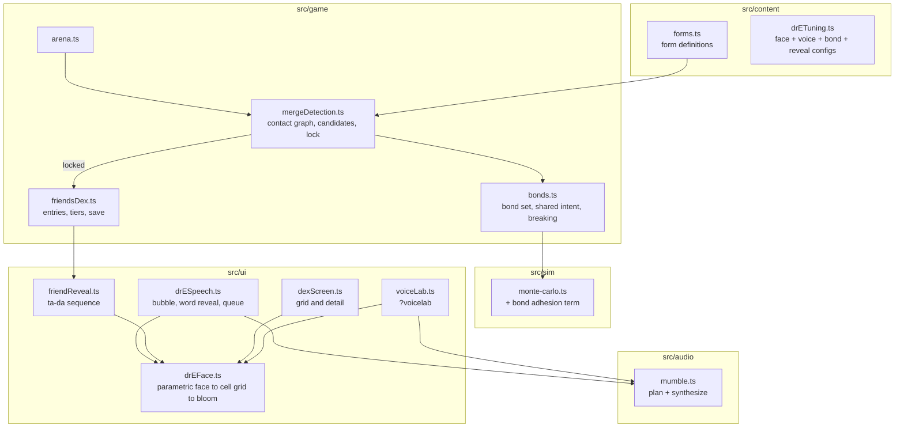

# Cellular Death Match v1: Dr. E, Stable Merges and the Friends Dex

Date: 2026-10-14 · Status: design for review · Branch at writing: `itch/boot-ident`

## 1. Summary

Cellular automata become the game's theme, mechanic, look and character.

- **Dr. E is a CA organism.** He is no longer a human professor. He is a friendly creature made of cells, with a face, a few expressions and a mouth that wobbles when he talks. "Dr. E" is a working name; a rename comes later.
- **He talks.** His lines type out in a speech bubble while he says them in Z13 mumble-speak, the nonsense voice from ps1-world. Johnny tunes the voice by hand.
- **Stable merges are the new mechanic.** When living cultures are coaxed into a particular shape and hold it, they lock into one bonded organism: a *form*.
- **You are rescuing his friends.** Every organism in the game is one of Dr. E's friends, collected in one numbered dex with rarity tiers, Pokémon-style. Finding one is a "ta-da" moment, and the dex is a pleasure to browse.

This is v1. Every release (itch.io, CrazyGames) is held until it ships.

### Platform

The platform stays open. v1 is a responsive web game for phones, tablets and desktop browsers. It may then ship to itch.io followed by Steam, or go to Steam alone. A Steam build would wrap the same web build in a desktop shell, chosen once Steam is confirmed. Rules that keep every option open:

- **Every screen works at every size**, from 360 × 640 to 3840 × 2160. That includes phone landscape, Steam Deck (1280 × 800) and ultrawide (3440 × 1440).
- **Prompts follow the last input used:** "Tap" on touch, "Click" with a mouse, key names with a keyboard. No copy assumes a phone.
- **The keyboard can drive every Dr. E and dex interaction** (advance, skip, open the dex, move between tiles), so controller support can map onto it later.
- **Saves go through the existing `runtimeStorage` wrapper**, never raw `localStorage`, so a desktop shell can swap the backing store.
- **The dex maps cleanly onto platform achievements** (tier milestones, each very rare). None are built in v1.

## 2. Intent

**Johnny's words.** CA is "the theme, mechanic, aesthetic and character". He wants Dr. E as "a CA face… a friendly CA organism" with "a narrative that you are rescuing his friends" and "a Pokémon gotta-catch-'em-all vibe". He wants "rare and very rare CAs to discover". Merges came from the title dish, where he saw "two red fused around the green": forms get "semi-locked", and "a stable merge mechanic can extend more things to discover". Dr. E's speech uses "our mumble speak technique… so when the text types out he actually talks", with "a quirky voice", "a few expressions and a bit of mouth wobble". Discovery needs "a tada moment" ("not exactly a card opening") and "a nice way to view your collection".

**Decisions made in the 2026-10-14 brainstorm** (Johnny chose these, or took the recommendation):

| Question | Decision |
| --- | --- |
| Release timing | Hold every release for this pivot; it is v1. The platform stays open: mobile web, itch.io, Steam. |
| How players get a merge | Coax it: bring the right cultures together with existing tools until the shape holds and locks. No new tool. |
| Collection structure | One dex, three tiers. Common: today's 14 strains. Rare: stable merges. Very rare: exotic forms that appear in long play. Dr. E is #000. |
| Dr. E's role | Host, in the style of Dr. Kawashima (Brain Training) or the Ace Attorney cast. He briefs, reacts and judges, mostly between rounds, and keeps quiet during play. |

**Success looks like this.**

- A first-time player hears Dr. E speak within ten seconds of pressing Run Trial.
- They rescue a rare friend inside the tutorial.
- They open the dex and see silhouettes they want to fill.
- A very rare find feels like an event worth telling someone about.

## 3. Pillars

1. **Everything is cells.** Dr. E, his friends, the dex, the title and the cover are all drawn from cells on a grid with the dish's bloom. No painted characters and no glossy renders.
2. **The sim is the straight man.** Merges lock through a new, tunable term in the simulation. The game never fakes a merge with a sprite or decides one happened unless the cells really hold the shape.
3. **Coax, don't craft.** Players rescue friends by shaping conditions with the tools they already have, not by following recipes.
4. **The host speaks between rounds.** Dr. E is never Clippy. He talks when there is something to learn, judge or celebrate, and is otherwise a quiet face in the corner.
5. **Tunable by hand.** Voice, face, bond strength, detection windows and ta-da timing are config objects Johnny can edit, save and swap.

## 4. The story

Dr. E is a merge himself: friend #000, a bonded little organism who runs the dish. Something (the Common Cold case, recast as a cold snap that shook every colony apart) broke his friends into loose cells scattered across the dish. They are still in there, alive but apart. Rescuing a friend means coaxing its cells back into shape until it holds.

The tone is warm and funny, not grim. The "Death Match" in the title is the dish's harsh ecology, which Dr. E is cheerfully used to. Cultures still eat each other; that is life in a dish, and part of what makes a rescue tricky.

Copy rules for every Dr. E line:

- One idea per bubble, and 90 characters or fewer. The voice engine caps a line at 180 characters, and short lines read better on a phone.
- He speaks in the first person and calls the forms by name.
- No exposition dumps. Anything longer than two bubbles becomes something the player does instead.

## 5. Core loop



A trial still ends with the existing banking flow. Friends rescued during a trial are banked with it. Open Lab runs the same loop with no trial goal, so the dex itself becomes the goal.

## 6. The Friends Dex

One numbered collection of everything alive.

| Tier | What it is | How it is found | v1 count |
| --- | --- | --- | --- |
| #000 | Dr. E | Given at the start | 1 |
| Common | The 14 existing strains: 6 egg strains, 5 reaction breeds and 3 hybrids | Exactly as today: eggs, reactions, cross-breeding | 14 |
| Rare | Stable merges of 2–4 cultures | Coaxed together and held for the lock window | 12 |
| Very rare | Exotic forms: merges that travel (gliders), pulse (oscillators) or grow from other merges | Arise on their own in long play; the player protects them until they lock | 5 |

v1 totals 32 entries. The 12 rares and 5 very rares are chosen from the merge census (§8.1), not invented at a desk. Forms that never happen naturally are discarded, and forms that happen too easily drop to the easy end of the rare tier.

Dex rules:

- Numbers run #000 (Dr. E), then commons, then rares, then very rares, so the number hints at rarity.
- Each entry has a name, a number, a tier, the strains it is made of, a one-line note from Dr. E, and the trial or dish where it was first found.
- An unfound entry shows its silhouette and tier, plus a hint once Dr. E has mentioned it. Very rare silhouettes stay hidden until the player has seen one form, so the tier keeps some mystery.
- The headline counter is "Friends found 9/32".
- Reactions stay in the notebook as techniques. They are things you do, not friends.

## 7. Dr. E, the CA character

### Look

Dr. E is a small colony: a round body culture with eye cells and a mouth, rendered on a coarse cell grid with the dish's bloom and palette. His edge flickers the way a real culture's membrane does, so he always looks alive.

The look test (slice A) puts 3–4 directions side by side, drawn by the real face renderer:

1. **The merge he is.** A green body with two red cells fused on as eyes or cheeks, a direct homage to the merge Johnny spotted on the title.
2. **Single-cell blob.** One soft body with eye and mouth holes cut from the membrane.
3. **The loupe.** The blob with one big glassy magnifier cell for an eye, carrying the old Dr. E's signature.
4. **Colony face.** Several small cells arranged into features, a little like a Pokémon made of bubbles.

### How he is drawn

A parametric face (body radius, eye positions and openness, mouth curve and opening, squash) is quantised every frame onto a grid of about 40 × 40 cells. A cheap cell rule then roughens the membrane edge and makes the interior shimmer. The result is drawn with the same three-layer bloom as `render.ts`. Expressions stay easy to author and blend, while every frame still reads as cells.

A live Potts mini-simulation of his face was considered and rejected for v1. It is the most "authentic" option, but expressions would be hard to control and costly to run in five places at once.

### Expressions (v1)

Neutral, happy, delighted, surprised, worried and thinking. Each is a preset of face parameters. Switching blends over about 150 ms. He blinks every 2–6 s and breathes with a slow squash.

### Talking

Mouth opening follows the voice plan's syllables: each syllable opens the mouth by its loudness and closes it as it fades. Stressed syllables add a small body bounce. When the voice is muted, the mouth still moves from the same plan, so he still visibly talks.

### Size and placement

He is a face, not a poster; the current portrait fills a phone screen.

| Slot | Phone | Desktop |
| --- | --- | --- |
| Speech bubble (coach) | 72 px face, bottom-left above the tool rack | 112 px face, docked by the HUD goal strip |
| HUD director | 44 px | 56 px |
| Big moments (welcome, ta-da, trial handoff) | Up to 30% of screen height, centred | Up to 36% of screen height |
| Title and cover | Allowed again, because he is CA: small, living in the dish, never covering the wordmark | Same |

All four current portrait slots move to the new renderer: the coach (which also hosts the first-run welcome), the HUD director, the method intro and the onboarding pointer. The pixel-art PNG retires, and the onboarding pointer becomes Dr. E himself pointing with a stretched pseudopod.

## 8. Stable merges

### 8.1 The merge census (before any design is final)

A headless probe, built in the style of `scripts/dish-longevity.ts`, runs many seeds of the open-lab dish and the five trial dishes. It records every small group of cultures in contact (2–6 cultures) that holds its arrangement for 2 s, 4 s and 8 s of dish time, keyed by its strains and contact shape. Its outputs:

- which shapes happen on their own, and how often (these seed the rare and very-rare lists);
- how long natural groups last, which sets the lock window;
- whether the "two red around a green" shape from the title is common, rare or a fluke.

### 8.2 Detection

Every 10 ticks the arena builds a contact graph: one node per living culture, and an edge wherever two cultures share boundary pixels. Small connected groups are matched against the form definitions. A form definition is a small graph whose nodes name strains (or "any hunter", "any grazer") and whose edges are required contacts. An optional condition can be attached, such as "inside a Salt field" or "while fed". Matching is brute force, which is cheap at six nodes or fewer.

A matched group becomes a *candidate*, tracked by its member culture IDs. If the same members keep matching for the form's lock window (about 4 s of dish time, set from the census), the candidate locks.

While a candidate is forming, the dish shows a faint ring around the group that fills like a progress meter. The player learns that something is happening and tries to protect it.

### 8.3 The lock: bonded organisms

Locking changes the physics, not just the labels:

- **Bond adhesion.** A new term in `monte-carlo.ts` gives a bonded pair lower energy when they share more boundary. Bonded cultures therefore prefer to stay touching, like the existing Ising term but between partners.
- **Shared intent.** Bonded cultures share one movement intent, so the form moves as one organism.
- **Breaking.** A bond breaks if the partners lose contact for longer than a grace period, for example when Toxin pushes them apart or Acid fragments one. The friend stays in the dex; only that dish instance dissolves.

Both terms read from one `BOND_TUNING` config (adhesion strength, intent blend, break grace). The term only runs for cultures that have bonds, so unbonded dishes cost nothing extra. It is deterministic under the fixed tick.

A locked form renders as one organism: a shared outer glow and a name tag. Each culture keeps its own colour, so the player can still see which strains it is made of.

### 8.4 Rare and very rare

- **Rare forms** are deliberate: 2–4 specific strains in a specific contact shape, sometimes with a condition. Players get them with paste trails, feeding and repelling. Difficulty comes from shape and strain choice, for instance three-culture rings, or a hunter and grazer that would normally eat each other.
- **Very rare forms** are emergent:
  - a locked merge that keeps travelling in one direction (glider);
  - a merge whose volume pulses on a steady period (oscillator);
  - a merge that bonds with another merge (compound).
  They are detected by behaviour over time as well as by shape, and they only arise in long play. When one is forming, Dr. E reacts: surprised, then urgent. The player's job is to protect it until it locks.

### 8.5 Where merges are off

The title dish keeps `breedDiscovery: false` and adds `mergeDiscovery: false`, so it never reveals an unfound friend. It may show forms the player has already found.

## 9. The ta-da moment

It should feel like a specimen rising out of the dish, not a card pack opening. The sequence, all skippable with a tap:



Tier scaling:

- **Common:** a first-time strain gets a short version: no slowdown, a stamp and a line from Dr. E.
- **Rare:** the full sequence, about 3 s.
- **Very rare:** a longer build, gold palette, a unique stinger and a haptic pattern on phones.

The droplet holds a live mini-render of the form, not a screenshot. Reduced motion swaps the movement for a fade with the same information. The existing genome-decode reveal (`fx.showGenomeDecode`) is replaced by this sequence.

## 10. The collection viewer

A Dex button sits in the chrome next to Options.

- **Grid:** every found friend is a tile running a tiny live render of its form, gently wobbling. Unfound tiles are dark silhouettes with a "?". Tabs filter by tier, and the counter heads the screen. Phones get 3 columns in a full-screen sheet; desktop gets a 6-column panel.
- **Detail view:** a large live specimen, the number, name, tier and strains, Dr. E's note (he says it in his voice when the page opens), and where and when it was found. A "how to find" hint appears for unfound entries he has hinted at.

The notebook keeps its Log and its reaction techniques. Its Atlas "Lifeforms" group is replaced by the dex, so there is one place for friends.

## 11. Dr. E's speech

### Voice engine

`src/audio/mumble.ts` is a TypeScript port of the browser prototype's engine (`ps1-world-unity/Tools/Mumble/prototype-core.cjs`, which preserves Codex's original):

- `plan()` turns a line into syllable events with word onsets. Each word's sound is seeded by its own spelling, so a name always sounds like itself.
- `synthesize()` renders the plan straight to samples at 24 kHz. It uses the prototype's four voices (Bog organ, Glass moth, Rust oracle, Bubble imp) with pitch, pace and "weird" controls.

Unlike Unity, the browser synthesises at runtime; there are no audio files. A line is rendered when it is queued, and the next line is rendered ahead while the current one plays. Playback goes through the existing UI audio context and respects the Sound mute. Ambience ducks slightly while he speaks. Options gets a "Dr. E's voice" on/off toggle next to Sound.

### Text reveal

Each word appears at its spoken onset from the plan, so text and voice stay in step. Punctuation pauses come from the plan too. A tap reveals the whole line and stops the voice; a second tap advances. With reduced motion, text appears whole, but the voice still plays unless muted. The text is always the caption.

### Voice profile and the Voice Lab

Dr. E's voice is one config object:

```ts
export const DR_E_VOICE = {
  voice: 'bubble',   // bog | glass | rust | bubble
  pitch: 3,          // semitones, -12..12
  pace: 1.1,         // 0.65..1.5
  weird: 0.6,        // 0..1
  gain: 0.8,
};
```

The values shown are placeholders until Johnny tunes them in the Voice Lab. The Voice Lab is a dev page at `?voicelab` with:

- a text box and preset lines from the script;
- sliders for every field;
- the live face with an expression picker;
- a Copy JSON button whose output is pasted into the config.

Saved profiles can be swapped, so other characters can get voices later.

### Speech bubble

The coach card becomes a speech bubble attached to Dr. E's face. The kicker, title and body collapse into one spoken line, plus an optional action chip ("Press Egg") and the step dots. On phones the bubble sits above the tool rack. On desktop it docks under the HUD goal strip, where the coach docks today. The event contract in `docs/onboarding-script-and-event-contract.md` (triggers, arrow targets, recovery timers) stays; only the presentation and the copy change.

## 12. The tutorial, recast

The first session teaches the new verb early, so the story lands before the player has to read anything long.

| Step | What happens | Dr. E (example lines, final copy in slice H) |
| --- | --- | --- |
| Hello | After Run Trial, Dr. E pops up big, then shrinks to his corner | "Oh! A visitor!" · "I'm Dr. E. I'm a merge." · "My friends came apart. Help me find them?" |
| Trial 1: Culture Shock | Today's egg and feed beats; Bloom Mass appears | "That's Bloom Mass! Friend number one." (common ta-da) |
| Trial 2: First Merge (new) | Coax two cultures together with a paste trail; the lock ring fills; first rare | "Closer… closer… hold it!" · "You did it! That's Twin Bloom." (rare ta-da) |
| Trials 3–6 | Today's four later trials (Bitter Medicine, Carrier Medium, Storm in a Dish, The Cure-ish), renumbered, each ending in a friend | Short lines between rounds only |
| Open Lab | Free rescue; Dr. E hints at one silhouette at a time | "I've seen something odd near Salt…" |

Trial 2 is new, so the case grows from five trials to six. The friend in Trial 2 (named "Twin Bloom" above as a placeholder) is chosen from the census as the easiest rare to coax. Today's Trial 2 (Bitter Medicine) becomes Trial 3, and so on.

Dr. E's interruption budget: in exact tutorial steps he stays up because he is the instruction. In hypothesis trials and Open Lab he gets at most two unprompted lines per trial, plus reactions to rescues. That matches today's idle rules.

## 13. Architecture



Unit responsibilities:

- **`mergeDetection.ts`** (pure). Input: sim state, archetypes and form definitions. Output: candidates with progress, and locks. Knows nothing about rendering.
- **`bonds.ts`** (pure). Owns the bond set. Shared intent is applied before the Monte Carlo sweep, and break checks run after it. The sim reads bonds through a small interface, so `src/sim` never imports game content.
- **`friendsDex.ts`**. Entry list, tier, found state and hints. Persisted inside the discovery save with a versioned key. It migrates existing strain discoveries to common entries one-to-one and grants #000 to everyone.
- **`drEFace.ts`**. `createDrEFace(canvas, profile)` returns `{ setExpression, speak(plan), stop, setSize }`. One small canvas per slot, paused when hidden.
- **`drESpeech.ts`**. Queues lines, renders voice ahead, reveals words in time with playback, handles tap-to-skip, and drives the face.
- **`mumble.ts`**. Pure planner and synthesiser. Its plans must match the prototype's exactly; a test checks this.

## 14. Tunables

All in `src/content/drETuning.ts` unless noted. No magic numbers in the systems themselves.

| Config | Fields |
| --- | --- |
| `DR_E_VOICE` | voice, pitch, pace, weird, gain |
| `DR_E_FACE` | grid size, palette, membrane roughness, blink range, breath rate, talk mouth gain, bounce, and per-expression presets |
| `BOND_TUNING` (`src/game/bonds.ts`) | adhesion strength, intent blend, break grace ticks |
| `MERGE_DETECTION` | scan interval, max group size, default lock window, ring style |
| `REVEAL_TIMING` | per-tier slowdown, durations, stingers, haptics |

## 15. Build order

Each slice gets its own implementation plan and is verified in the running game on phone and desktop before the next one starts.

| Slice | Delivers | Depends on |
| --- | --- | --- |
| A. Look test | Face renderer prototype; 3–4 directions on one sheet; Johnny picks | — |
| B. Voice | `mumble.ts` port with parity test; Voice Lab; Johnny tunes Dr. E's voice | — (in parallel with A) |
| C. Dr. E in game | Face module, expressions, talking mouth, speech bubble replacing the coach card, in all four slots | A, B |
| D. Merge census | Probe script and report; v1 rare and very-rare list | — (in parallel with A–C) |
| E. Merges | Bond term, detection, lock, forming ring, dish rendering of forms | D |
| F. Dex | Data, save migration, collection viewer, Dex button | E |
| G. Ta-da | Reveal sequence by tier | C, F |
| H. Tutorial | New script, Trial 2 First Merge, event contract update | C, E, G |
| I. Very rare | Behaviour detection (glider, oscillator, compound) and long-play tuning | E, F |
| J. Brand | Title, cover and app icon with Dr. E (the icon is still the old painted professor), store copy, release checklist | all |

## 16. Verification

- **Unit tests:**
  - mumble plan parity with `prototype-core.cjs`;
  - form matching, including negative cases;
  - candidate persistence and lock timing;
  - bond determinism (same seed, same result);
  - bond breaking;
  - dex save migration from today's save.
- **Probes:** the merge census; `dish-longevity.ts` run with bonds on, to confirm merges do not freeze the ecology.
- **E2E:** the full first session on phone and desktop, including the first rare rescue, with audio muted and unmuted; dex open and close; reduced motion.
- **Performance budgets** (measured, not assumed):
  - detection under 0.3 ms per scan at 160 × 160;
  - bond term overhead under 5% of tick time;
  - face render under 1 ms per frame per slot;
  - voice synthesis under 40 ms per line on a mid-range phone.
- **Look:** screenshots of every new screen at 360 × 640, 390 × 844, 844 × 390, 768 × 1024, 1280 × 800 (Steam Deck), 1440 × 900, 2560 × 1440, 3440 × 1440 and 3840 × 2160.

## 17. Risks

- **Bonds might feel sticky or frozen.** Tune `BOND_TUNING` with the longevity probe, and keep break grace short enough that the dish stays lively.
- **There may not be enough natural merges for 12 rares.** The census tells us early. The fallback is to add conditions (reagent fields) that make specific shapes likelier, without adding a crafting tool.
- **Voice cost on low-end phones.** Lines are short, synthesis is per line, and the next line renders ahead. If a line is still slow, cache rendered lines by text.
- **Dr. E could turn into Clippy.** Follow the interruption budget, keep every line skippable, and keep Options → Dr. E's voice (on/off) next to Sound.
- **The rename lands late.** The name lives in one constant, and voice tests use the line text, so renaming means changing one string and re-recording nothing.

## 18. Supersedes

- The pixel-art professor (`public/art/professor/dr-e-mergent-pixel.png`) and the rule that Dr. E stays off brand surfaces. He may appear on them as a CA.
- The genome-decode reveal (`fx.showGenomeDecode`), replaced by the ta-da sequence.
- The Atlas "Lifeforms" group, replaced by the dex.
- The five-trial Common Cold case, which becomes six trials with the new Trial 2.

## 19. Noted for later (not in this design)

- **Choose-upgrade screen.** It works, but Johnny finds it visually weak (2026-10-14). It needs a visual pass after v1's core slices; no change to how it functions.
